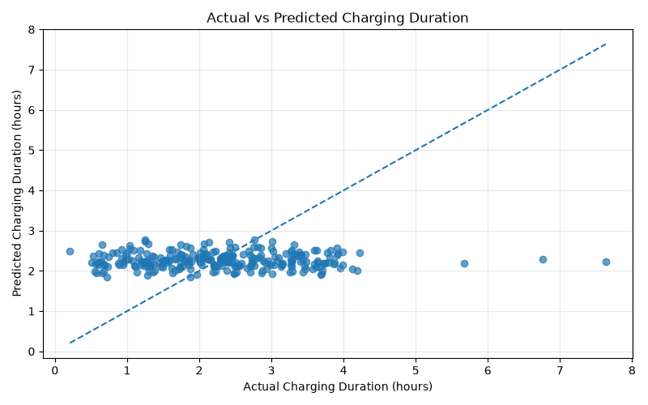

# EV Charging Duration Prediction

Predicting electric vehicle charging duration using exploratory data analysis and a Linear Regression model.

## Team Members and Roles

| Team Member | Role and Contribution |
|---|---|
| anika-s40 | Documentation Lead |
| Samarthgupta1406 | Video Lead|
| Aryan-iitrpr | Execution Lead |
| SaurabhDagar29 | PPT Lead |

All team members contributed to the project according to their assigned responsibilities. The roles above should be updated to reflect the actual work performed by each member.

## Problem Statement

Electric vehicle charging duration can depend on factors such as battery capacity, charging rate, starting state of charge, vehicle model, and environmental conditions.

The objective of this project is to explore an EV charging dataset and build a regression model to predict **Charging Duration (hours)** from selected vehicle, charging, and environmental features.

## Dataset

- **File:** `data/ev_charging_patterns.csv`
- **Rows:** 1,320
- **Columns:** 20
- **Target variable:** `Charging Duration (hours)`
- **Dataset source:** [Electric Vehicle Charging Patterns — Kaggle](https://www.kaggle.com/datasets/valakhorasani/electric-vehicle-charging-patterns)

The dataset contains vehicle details, battery capacity, charging rate, charging duration, energy consumed, charging cost, time information, state of charge, temperature, charger type, and user type.

## Project Structure

```text
ev-charging-duration-prediction/
├── data/
│   └── ev_charging_patterns.csv
├── outputs/
│   ├── duration_distribution.png
│   ├── actual_vs_predicted.png
│   ├── residual_plot.png
│   └── evaluation_metrics.csv
├── ev_charging_prediction.py
├── requirements.txt
├── .gitignore
└── README.md
```

## Requirements

- Python 3
- pip

The Python libraries used include NumPy, pandas, Matplotlib, Seaborn, and scikit-learn.

## Setup and Run

Clone the repository:

```bash
git clone https://github.com/Aryan-iitrpr/ev-charging-duration-prediction.git
cd ev-charging-duration-prediction
```

Create and activate a virtual environment on macOS/Linux:

```bash
python3 -m venv .venv
source .venv/bin/activate
```

Install dependencies:

```bash
python -m pip install --upgrade pip
pip install -r requirements.txt
```

Run the project:

```bash
python ev_charging_prediction.py
```

The script reads the dataset from the repository's `data/` folder, performs analysis, trains and evaluates the models, and saves output files in the `outputs/` folder.

## Expected Output

After running the project, the following files will be generated in the `outputs/` folder:

- `duration_distribution.png` — Distribution of charging duration.
- `actual_vs_predicted.png` — Actual versus predicted charging durations.
- `residual_plot.png` — Residual plot for the Linear Regression model.
- `evaluation_metrics.csv` — Evaluation metrics for the baseline and Linear Regression models.

### Actual vs Predicted Charging Duration




## Methodology

1. Load and inspect the dataset.
2. Calculate descriptive statistics (mean,median etc.) and examine correlations.
3. Visualize the distribution of charging duration using graphs. 
4. Select vehicle, charging, and environmental features.
5. Handle missing numerical and categorical values using preprocessing pipelines.
6. Split the data into training and test sets.
7. Train a Linear Regression model.
8. Compare it with a mean-prediction baseline.
9. Evaluate the predictions using MAE, RMSE, and R².
10. Save the evaluation metrics and visualizations. 

## Results

The current test-set results are:

| Model | MAE (hours) | RMSE (hours) | R² |
|---|---:|---:|---:|
| Mean baseline | 0.8579 | 1.0754 | approximately 0.0000 |
| Linear Regression | 0.8726 | 1.0996 | -0.0455 |

The Linear Regression model performed slightly worse than the mean baseline on the test set. Its negative R² indicates that, on this split, it performed worse than predicting the mean target value.

These results suggest that the selected features and linear model do not yet provide strong predictive performance. Further feature analysis, data-quality checks, and experiments with other models may improve the results.

## Output Files

- `duration_distribution.png`: Distribution of charging duration.
- `actual_vs_predicted.png`: Actual versus predicted charging durations on the test set.
- `residual_plot.png`: Residuals against predicted values.
- `evaluation_metrics.csv`: Model evaluation metrics.

## Presentation and Demo

- **Slides:** [Add your presentation link]
- **Demo video (5 minutes maximum):** [Add your video link]

## AI-Use Disclosure

AI assistance was used for guidance on project development, debugging, explanations, and documentation. The code was run and the reported results were checked against the local program output. All team members should review the final code and understand the work they submit. Update this disclosure to accurately reflect the tools used and each person's contribution.

## Limitations and Future Work

- The current Linear Regression model does not outperform the mean baseline.
- Investigate relationships between selected features and charging duration.
- Check for data-quality issues and potentially informative features.
- Experiment with other regression models and compare their test-set performance.

## Reproducibility

The project uses a fixed random state for the train-test split. For consistent reproduction across machines, the Python and library versions should also be documented and pinned.
